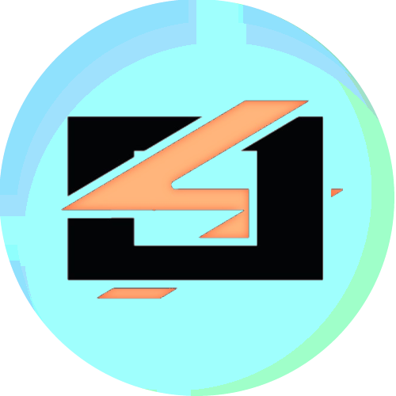
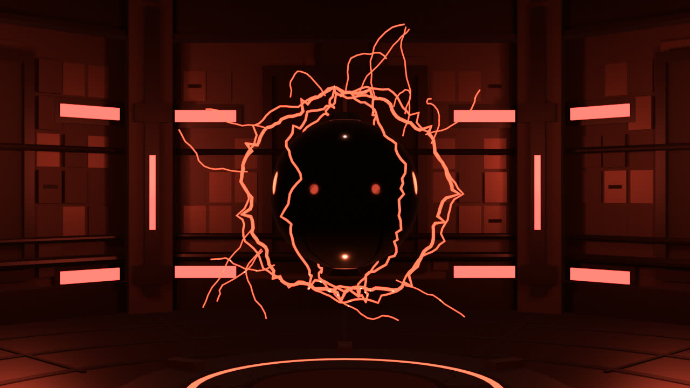
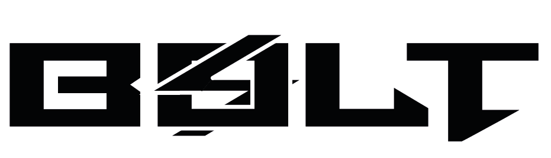

<div align="center">



# DarkCircle Suite

**Private payments, AMM liquidity, multi-sig custody, a real estate brokerage, grand guild halls and a talent escrow rail on Quai Network, behind one 3D portal.**

<br />


<br />

[The portal](#the-portal) &nbsp;·&nbsp; [The six apps](#the-six-apps) &nbsp;·&nbsp; [Build and run](#build-and-run) &nbsp;·&nbsp; [Deployment](#deployment) &nbsp;·&nbsp; [Quality gates](#quality-gates) &nbsp;·&nbsp; [Known limitations](#known-limitations)

<br />



<sub>The QRB containment chamber, rendered from <code>assets/3d/qrb_chamber.blend</code>. It is rebuilt from code by <code>tools/build_qrb_scene.py</code>.</sub>

</div>

---

## The portal

`index.html` is a real-time WebGL front door to the suite. A black obsidian orb hovers inside a crimson-lit octagonal containment vault, wrapped in a ring of plasma. The six apps ride a carousel round the orb, one node each on a glowing track: the node at the front haloes the orb and is the selected app, and the arrows on either side spin the ring one step either way. It opens on **Circleswap** in front, **DarkCircle** and **DarkSafe** to either side, and **Dark Questate**, **DarkOrder** and **Dark Star Rail** behind the orb.

| Input | Action |
|---|---|
| Drag | Orbit the chamber |
| ‹ › arrows, `←` `→` | Spin the carousel one app either way |
| Click a side node | Spin it to the front |
| Click the front node (the orb), `Enter` | Warp transition into the selected app |
| Click a card or pill, `1` `2` `3` `4` `5` `6` | Spin that app to the front, then warp to DarkCircle, Circleswap, DarkSafe, Dark Questate, DarkOrder, Dark Star Rail |
| Hover a node | Telemetry readout: node, route, live Cyprus-1 block height |
| Sound button | Synthesized reactor hum and cues (Web Audio, muted by default) |
| Book button | Opens the documentation and guides in `docs/` |
| Phone tilt | Parallax (iOS asks for permission on first touch) |
| `?mode=2d` | Force the 2D card portal |

**Graceful degradation.** No WebGL, a failed GPU context, a missing model file or `prefers-reduced-motion` all land on a working 2D portal or a calmer 3D one. The links are plain anchors, so navigation never depends on the 3D engine. In the 2D portal the arrows still work: they move the highlight across the cards, and `Enter` opens the highlighted app.

**Privacy.** The portal loads nothing from a third-party host: three.js and every add-on are vendored under `assets/3d/vendor/`, and there are no web fonts. The only network call is a single read-only `quai_blockNumber` to `rpc.quai.network`, made the first time you target a node or spin the carousel, with credentials and referrer omitted. The bottom bar shows its state (`RPC idle`, `querying`, `CYPRUS-1 #...`).

### Subdomain and path routing

| Host starts with | Goes to |
|---|---|
| `q0.` `circleswap.` or contains `q0-` | `/q0/` |
| `darksafe.` `safe.` `multisig.` or contains `darksafe-` | `/multisigows/` |
| `tumbler.` `privacy.` `x402.` or contains `tumbler-` | `/x402tumbler/` |
| `questate.` `darkquestate.` `realestate.` or contains `questate-` | `/darkquestate/` |
| `darkorder.` `guild.` `halls.` or contains `darkorder-` | `/darkorder/` |
| `darkstarrail.` `starrail.` `rail.` `talent.` or contains `starrail-` | `/bai/` |

`404.html` applies the same rules to deep links and keeps the `/<repo>/` prefix on GitHub project pages. A deep link under `/questate/` goes to `/darkquestate/`; a deep link under `/guildhalls/` goes to `/darkorder/`.

---

## The six apps

| | App | Route | What it is | Where it stands |
|---|---|---|---|---|
| 🛡️ | **DarkCircle**<br/>`x402tumbler/` | `/x402tumbler/` | x402 payment privacy on Quai: WQUAI and WQI shielded pools, PPOI compliance, ephemeral payees, a voice agent | Runs against an **in-memory simulation**. Nothing is deployed on Quai and no funds move. Circuit and pool contract are reference implementations, unaudited. The voice agent page is the one real-chain feature, and your wallet signs every step |
| ⚡ | **Circleswap**<br/>`q0/` | `/q0/` | Quai DeFi dashboard: pool analytics, swap math, LP, and a chain-driven Farms & Pools page with an owner admin dashboard for adding pairs | Reads live Cyprus-1 data. Transactions are signed by your own wallet extension. `SECURITY_AUDIT.md` is an internal, AI-assisted review and **not** an external audit |
| 🔐 | **DarkSafe**<br/>`multisigows/` | `/multisigows/` | DarkSafe multi-sig vaults: on-chain proposals, native timelock, quorum checks, no `DELEGATECALL` | Extension-only signing, no bundled signer. The vault contract has not had an independent security audit |
| 🏠 | **Dark Questate**<br/>`b6/` | `/darkquestate/` | Real estate brokerage on Quai: title-verified properties as EIP-6065 deeds, listings through registered brokers, offers held in escrow, closings that move the deed and the money in one transaction | The contracts (`QuestateDeed`, `QuestateBrokerage`) are **not deployed** on Orchard or mainnet, so the site runs as a **labelled showcase**: invented sample listings, marked as such, with every transaction switched off. No independent audit |
| ⚔️ | **DarkOrder**<br/>`d0/` | `/darkorder/` | The Grand Guild Halls: found a guild with its own governance, dues and reward token stack in one transaction, govern members by QNS name (quaidomains.com), pay dues over x402, and drive every flow with a voice seneschal that turns speech into signed intent | The contracts (`GuildFactory`, `GuildHall`, `TokenStackDeployer`) are **not deployed** on Orchard or mainnet, so the site runs as a **labelled showcase**: invented sample halls, marked as such, with every transaction switched off. No independent audit |
| 🛤️ | **Dark Star Rail**<br/>`bai/` | `/bai/` | The talent agency rail: hire verified AI/human talent into milestone escrow, settle gaslessly over x402 (one approval + an EIP-712 signature — the suite facilitator pays gas), 2.5% protocol fee, dispute windows | **Deployed and live-verified on Orchard and mainnet Cyprus-1** (bridged-USDT settlement); full gasless flow proven by an on-chain smoke test. Slither/Hardhat/Foundry suites green. **No external audit yet** — keep value modest |

Each app has its own README with the details: [`x402tumbler/`](x402tumbler/README.md), [`q0/`](q0/README.md), [`multisigows/`](multisigows/README.md), [`b6/`](b6/README.md), [`d0/`](d0/README.md), [`bai/`](bai/README.md).

> **Treat everything here as pre-release.** Do not point any of it at funds you cannot afford to lose.

---

## Repository layout

```
.
├── index.html                  3D portal + subdomain router (single file, ASCII-only)
├── 404.html                    base-path-aware redirect for deep links and subdomains
├── docs/                       documentation and guides (static HTML, no build step)
├── 0.png  Boltfont.png         brand mark and "Powered by" wordmark (copied into each app)
├── assets/3d/
│   ├── qrb_chamber.glb         web asset (generated)
│   ├── qrb_chamber.blend       Blender source (generated)
│   ├── qrb_chamber_preview.jpg README hero render
│   └── vendor/three/           three.js r160 + the add-ons the portal uses (MIT)
├── tools/
│   ├── build_qrb_scene.py      procedural Blender builder  ->  .blend + .glb
│   ├── verify_qrb_assets.mjs   structural gate for the .glb
│   ├── assemble_site.sh        builds the Pages bundle (CI and local)
│   ├── check_legacy_name.sh    fails if the retired product name reappears
│   └── test_404_router.mjs     behavioural test for the redirect router
├── x402tumbler/                DarkCircle
├── q0/                         Circleswap
├── multisigows/                DarkSafe
├── b6/                         Dark Questate
├── d0/                         DarkOrder (Grand Guild Halls)
└── .github/workflows/          ci.yml (tests every app), deploy-pages.yml
```

---

## Build and run

You need Node 22+, pnpm 10 and, only to regenerate the 3D asset, Blender 5.x.

**1. Build the apps** (the same commands CI runs):

```bash
(cd q0 && pnpm install --frozen-lockfile \
  && pnpm --filter quai-service build && pnpm --filter stats-app build)

(cd multisigows && pnpm install --frozen-lockfile \
  && pnpm --filter @darksafe/core build  && pnpm --filter @darksafe/ui build \
  && pnpm --filter @darksafe/verify build && pnpm --filter @darksafe/watcher build \
  && pnpm --filter @darksafe/web build)

(cd b6 && pnpm install --frozen-lockfile \
  && pnpm build && pnpm test && pnpm integrity)

(cd d0 && pnpm install --frozen-lockfile \
  && pnpm build && pnpm test && pnpm integrity)
```

Dark Questate's tests include an end-to-end run against a Hardhat node they start on `127.0.0.1:18545`, so that port must be free. DarkOrder's suites are unit tests plus Hardhat's in-process network, so they bind nothing.

**2. Assemble and serve the unified site:**

```bash
bash tools/assemble_site.sh _site
python -m http.server 8080 --directory _site     # then open http://localhost:8080
```

`assemble_site.sh` exits non-zero if any destination the portal links to is missing from the bundle.

**3. Regenerate the 3D scene** (optional; the committed `.glb` is what ships):

```bash
blender --background --python tools/build_qrb_scene.py
blender --background --python tools/build_qrb_scene.py -- --preview out.png --frame 30 --no-export
node tools/verify_qrb_assets.mjs
```

On Windows Blender lives at `C:\Program Files\Blender Foundation\Blender 5.2\blender.exe`.

### About the 3D asset

| | |
|---|---|
| Space | Y-up, metres. Orb centre at `(0, 1.7, 0)`, radius 0.5. Room: 14.8 m across, 4.6 m high |
| Size | about 24k triangles, 790 KB `.glb`, 10 PBR materials, no textures |
| Lights | 7 punctual lights, exported unitless (`COMPAT`) so three.js does not blow out |
| Animation | Four 5-second loop clips: orb hover, plasma spin, plasma sweep, camera push |
| Reference | Proportions and bar positions are measured from the QRB artwork `q0/QgoGIF.gif` (`ar://MbJXaZJwc0PjrCK2iwBblrR6m0aAYIUJ7xsIIpQpHQk`) |

---

## Deployment

`.github/workflows/deploy-pages.yml` runs on every push to `main`:

1. Verify the 3D asset, check portal sources are pure ASCII, test the redirect router, run the Circleswap unit tests
2. Refresh the Quainance launchpad snapshot (best effort), then build Circleswap and DarkSafe
3. Build Dark Questate and DarkOrder, run their tests and their integrity gates (a failure stops the deploy)
4. Check out BOLTEVM/BTAI and static-export the Dark Star Rail frontend rooted at `/bai/` (`PAGES_BASE_PATH=/bai`). The wallet flow needs the `BTAI_PRIVY_APP_ID` Actions secret (a Privy app id is client-side public); the talent API URL comes from the `BTAI_API_BASE_URL` Actions variable
5. `tools/assemble_site.sh _site`
6. Upload and deploy to GitHub Pages

`.github/workflows/ci.yml` runs on every push and pull request and is what says a change is safe: Circleswap (types, unit tests, bun tests, the contract suites, production build), DarkSafe (build, types, core / web / verifier / watcher tests), Dark Questate (contract suites, Foundry fuzz and invariant campaigns, forge lint, SDK tests including the end-to-end run on a local Hardhat node, web tests, integrity gate), DarkOrder (contract suites, Foundry fuzz and invariant campaigns, forge lint, Slither, core units covering the voice grammar / x402 challenge / QNS naming, web tests, integrity gate) and the DarkCircle console (types and its 915 tests), each with a production dependency audit. DarkSafe's contract jobs (Slither, Foundry, coverage) are in `multisigows/.github/workflows/ci.yml` and run when that folder is its own repository.

The bundle contains `index.html`, `404.html`, the `.glb`, the vendored three.js, and each app's static build under its route (plus the `circleswap/`, `darksafe/` and `darkcircle/` aliases). Dark Questate ships once, as `darkquestate/`: the `b6/` folder name is never published. DarkOrder ships once, as `darkorder/`: the `d0/` folder name is never published. Dark Star Rail ships once, as `bai/`: its Next.js export uses absolute `/bai/` asset URLs, so the `darkstarrail/` and `starrail/` aliases are 404-router redirects, not copies. The `.blend` is source and is not published.

---

## Quality gates

| Gate | Command | What it catches |
|---|---|---|
| Asset structure | `node tools/verify_qrb_assets.mjs` | Wrong up-axis, orb or room scale, lights exported in physical units, a light pointing the wrong way, an animation loop that stalls at the seam, unused UVs, triangle and size budgets |
| Token metadata | `node --test q0/packages/quai-service/test/tokenMetadata.test.ts` | Decoding of untrusted contract output, chain-first precedence (decimals never from the explorer, never defaulted to 0), icon-URL resolution, TTL and negative caching |
| Redirect router | `node tools/test_404_router.mjs` | Project-pages prefix loss, subdomain and deep-link redirects, and the portal's own subdomain router disagreeing with `404.html` |
| Brand | `bash tools/check_legacy_name.sh` | The retired product name reappearing anywhere in tracked text (the multi-sig app is DarkSafe) |
| Portal encoding | CI step | Any non-ASCII byte in `index.html` or `404.html` (the first build shipped corrupted dashes and emoji) |
| Bundle integrity | `bash tools/assemble_site.sh` | A navigation target or vendored module missing from the deployed bundle |
| Dark Questate integrity | `cd b6 && pnpm integrity` | Names, fake IPFS CIDs or a misattributed pool address from the old b6 demo coming back, wrong chain ids, the local dev wallet in the production bundle |
| DarkOrder integrity | `cd d0 && pnpm integrity` | Legacy d0 codenames or a foreign chain id coming back, the local dev wallet in the production bundle, the voice grammar accepting a raw address |
| DarkOrder fuzz | `cd d0/packages/contracts && forge test` | 43 fuzz properties and 3 invariant campaigns over the exact Hardhat-compiled bytecode: the QNS charset rule, the permission wall, all-or-nothing batches, vote tallies and threshold arithmetic, quorum at execution, treasury accounting |
| Dark Questate fuzz | `cd b6/packages/contracts && forge test` | 27 fuzz properties and 2 invariant campaigns over the exact Hardhat-compiled bytecode: registrar-only servicing, custody on listing, the settlement split against the quote, the money identity (desk balance == proceeds + offer escrow), parcel uniqueness, foreclosure monotonicity, hostile payees |

---

## Known limitations

These are tracked, not hidden:

- **DarkCircle on static hosting.** Its UI expects the local API from `pnpm ui` in `x402tumbler/`. On Pages there is no server, so the page recognises that, shows a "Static preview" banner, switches its actions off and makes no API calls.
- **Circleswap on static hosting.** Neither the explorer's indexed stats nor Quainance's launchpad catalog send a CORS header, so the hosted page does not request them: USD values come from pool reserves, and Hartii / POOP / curve launches come from a snapshot taken at deploy time and labelled with its date. Token metadata is unaffected: it uses the CORS-open `/api/token/<address>` endpoint and the RPC.
- **Wallet extensions.** Every app treats an injected wallet as untrusted input: a provider that throws or lacks events is reported as absent rather than allowed to break the page, and Circleswap shows a crash screen with details instead of a blank page.
- **Dark Questate on static hosting.** Until its contracts are deployed and recorded in `b6/packages/core/src/deployments.ts`, the hosted site shows invented sample listings with a "Showcase" banner, and every transaction is switched off.
- **DarkOrder on static hosting.** Until its contracts are deployed and recorded in `d0/packages/core/src/deployments.ts`, the hosted site shows invented sample halls with a "Showcase" banner, and every transaction is switched off. QNS names resolve only against a live deployment.
- **Portal metrics.** The hover readout shows the Cyprus-1 block height only. Pool TVL and vault status are not wired in.
- **No licence file yet.** Until one is added, reuse rights are unspecified. The vendored three.js keeps its MIT licence in `assets/3d/vendor/three/LICENSE`.

---

<div align="center">


<sub>Built on **Quai Network** (Cyprus-1, chain id 9) &nbsp;·&nbsp; **BOLTEVM**</sub>

<a href="https://boltevm.com"><sub>Powered by</sub> </a>

</div>
